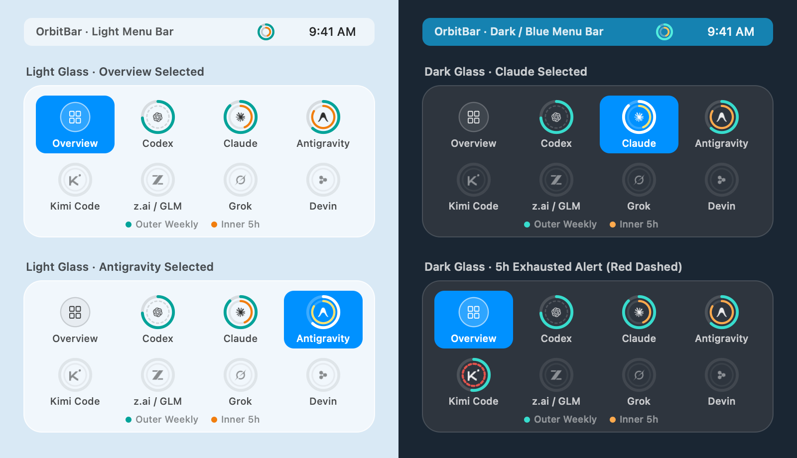

# OrbitBar

**Dual-Ring AI Usage Bar for macOS.**

*Outer orbit = Weekly / 30-day remaining quota · Inner orbit = 5-hour session remaining quota — across Claude, Gemini/Antigravity, Codex, Kimi Code, GLM, Grok, Devin, and more.*

[简体中文](README.zh-CN.md)



## Why OrbitBar?

Modern AI coding subscriptions rarely have just one limit — almost all of them combine a **weekly/monthly** budget with a rolling **5-hour session window**.

When running [CodexBar](https://github.com/steipete/CodexBar) to monitor multiple AI providers in one macOS menu bar item, its default provider switcher shows a single flat 2px line beneath each logo, and its merged menu bar icon is a monochrome pill.

**OrbitBar** upgrades both into crisp Retina CoreGraphics **concentric dual-ring dials** — while keeping 100% of the host app's native menus, usage overview, per-provider details, refresh actions, keyboard shortcuts, and Settings completely intact.

## Features

- **Dual-Ring Top Provider Switcher**
  - **Outer ring (thick, teal)**: weekly / 30-day remaining quota (shifts to amber below 20%).
  - **Inner ring (thin, warm amber)**: 5-hour / daily remaining quota (shifts to red below 20%, dashed red ring when exhausted at 0%).
  - **Single-window plans** (e.g. 30-day only): delicate dashed neutral inner ring so you instantly know there is no 5-hour cap.
  - **High-contrast selected state**: automatically switches to crisp white outer + luminous gold inner on macOS system blue selection pills.
  - **Light & Dark Liquid Glass adaptive** + localized micro-legend (`Outer Weekly · Inner 5h` / `外圈 周额度 · 内圈 5小时`) + per-provider hover tooltips.
- **Dual-Ring Menu Bar Icon**
  - Replaces the default monochrome capsule with an `18×18pt` Retina dual-ring gauge that adapts to light, dark, and colorful macOS wallpapers.
  - Automatically follows your active provider tab (or the `#1` recommended provider in `Overview` mode).
  - Switch between `color` (default), `monochrome`, or `native` menu bar icon styles via `defaults write` without rebuilding.
- **Native, Lightweight, Reversible**
  - ~235 KB pure Swift + AppKit + CoreGraphics `.dylib` linked weakly (`LC_LOAD_WEAK_DYLIB`).
  - Zero background daemons, zero WebViews, zero external dependencies.
  - Supports both upstream [steipete/CodexBar](https://github.com/steipete/CodexBar) (`widget-snapshot.json`) and membership-summary forks (`codexbar-summary.json`).
  - Fully reversible in one command (`make uninstall`).

## Requirements

- macOS 14.0+ (Apple Silicon, Intel, or Universal — matched automatically)
- Xcode Command Line Tools (`swiftc`, `clang`, `codesign`)
- [CodexBar](https://github.com/steipete/CodexBar) installed in `/Applications/CodexBar.app` or `~/Applications/CodexBar.app`

## Installation

```bash
git clone https://github.com/shikaizhong-design/orbitbar.git
cd orbitbar
make install
```

Or specify a custom app bundle path:

```bash
./Scripts/install.sh --app /path/to/CodexBar.app
```

What `install.sh` does:
1. Compiles `OrbitBar.dylib` matching the host app's architecture(s) (`arm64` / Universal).
2. Saves an untouched backup of the original executable at `~/Library/Application Support/OrbitBar/CodexBar.orbitbar-backup`.
3. Installs `OrbitBar.dylib` into `Contents/Frameworks/` and appends a weak `LC_LOAD_WEAK_DYLIB` entry (`@rpath/OrbitBar.dylib`).
4. Ad-hoc re-signs the app bundle (`codesign --force --sign -`), verifies `codesign --verify --deep --strict`, and restarts the menu bar app.

> **Note on ad-hoc re-signing:** Modifying an app bundle replaces its original Developer ID signature with a local ad-hoc signature. On official Developer ID–signed CodexBar builds, macOS may prompt once to re-allow Keychain access on first launch after installation.

## Menu Bar Icon Styles

Switch styles anytime without rebuilding (replace `local.quota.codexbar` with `com.steipete.codexbar` on upstream CodexBar):

```bash
# Default: vibrant color dual-ring (teal outer + warm amber inner)
defaults write local.quota.codexbar OrbitBarMenuBarStyle -string color

# Native macOS template monochrome dual-ring
defaults write local.quota.codexbar OrbitBarMenuBarStyle -string monochrome

# Keep the host app's original menu bar icon (only upgrade the dropdown switcher)
defaults write local.quota.codexbar OrbitBarMenuBarStyle -string native
```

## Uninstall

Restore the exact original executable and remove `OrbitBar.dylib`:

```bash
make uninstall
```

## How It Works

`OrbitBar.dylib` hooks only public AppKit selectors via the Objective-C runtime (`NSMenuItem.setView:`, `NSStatusBarButton.setImage:`, and switcher lifecycle methods) with zero hardcoded Swift struct/ivar offsets. It watches the local snapshot directory using a kernel `DispatchSource` (`O_EVTONLY`) and redraws Retina dials on demand in CoreGraphics.

## Credits & License

- Built as an independent visual plugin for [CodexBar](https://github.com/steipete/CodexBar) by Peter Steinberger (MIT License).
- This repository contains only original plugin source code and installation scripts; no CodexBar binaries or source files are redistributed here.
- Licensed under the [MIT License](LICENSE).
