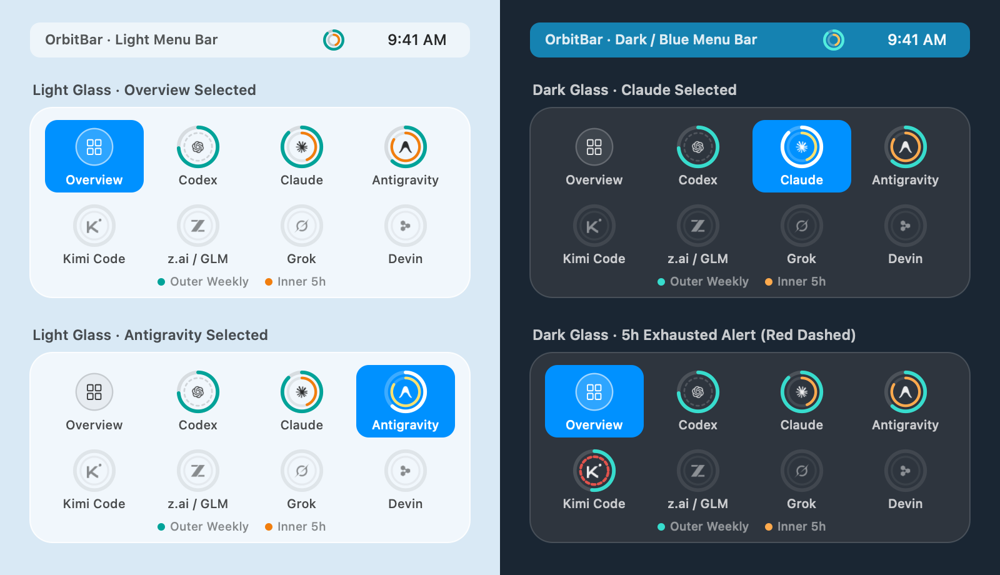

# OrbitBar

**给你的 macOS 菜单栏装上多平台 AI 额度同心双环表盘。**

*外圈 = 周 / 30 天剩余额度 · 内圈 = 5 小时短窗剩余额度 —— 统一覆盖 Claude、Gemini / Antigravity、Codex、Kimi Code、GLM、Grok、Devin 等多模型订阅。*

[English](README.md)



## 为什么做 OrbitBar？

主流 AI 编程订阅几乎都是**双窗口机制**：一个**周 / 月长期池** + 一个**5 小时滚动短窗**。

使用 [CodexBar](https://github.com/steipete/CodexBar) 在 macOS 顶栏聚合多平台额度时，原版顶部切换栏只在每个图标下方显示一条 2px 细横条，合并顶栏图标也是一个单色小胶囊。

**OrbitBar** 在 **100% 保留原有下拉菜单全部功能**（总览、今日用量、28 天柱图、各平台详情页、刷新、设置、快捷键）的前提下，把两处核心视觉升级为原生 Retina **同心双环表盘**：

1. **下拉菜单顶部平台切换栏**：每个平台升级为 `36pt` 同心双环（品牌标居中、外圈周额度、内圈 5 小时额度）。
2. **Mac 顶部菜单栏图标**：将原版单色胶囊替换为 `18×18pt` Retina 彩色精工双环，自动适配浅色、深色与彩色壁纸顶栏。

## 核心特性

- **一眼读懂的双环视觉语言**
  - **外圈（青绿粗环）**：周 / 30 天剩余额度（低于 20% 自动转琥珀提醒）。
  - **内圈（暖橙细环）**：5 小时 / 日短窗剩余额度（低于 20% 转红，耗尽为 0% 时显示红虚线预警）。
  - **单窗口套餐**（如仅有 30 天额度的免费档）：内圈显示淡灰虚线，一眼区分无 5 小时限额。
  - **选中态高对比自适应**：选中变系统蓝底时，外圈自动切纯白、内圈切亮金，依然清晰锐利。
- **原生轻量、零额外进程**
  - 纯 Swift + AppKit + CoreGraphics 编写，编译产物约 `235 KB`，无后台常驻进程、无 WebView、无第三方依赖。
  - 自动兼容原版 `steipete/CodexBar`（读取 `widget-snapshot.json`）与会员额度看板分支（读取 `codexbar-summary.json`）。
  - 通过 `LC_LOAD_WEAK_DYLIB` 弱链接接入，自动备份原执行文件，一条命令即可完整卸载还原。

## 环境要求

- macOS 14.0+（自动匹配 Apple Silicon / Intel / Universal 架构）
- Xcode Command Line Tools（`swiftc`、`clang`、`codesign`）
- 本机已安装宿主菜单栏应用 [CodexBar](https://github.com/steipete/CodexBar)（`/Applications/CodexBar.app` 或 `~/Applications/CodexBar.app`）

## 一键安装

```bash
git clone https://github.com/shikaizhong-design/orbitbar.git
cd orbitbar
make install
```

如需指定自定义安装路径：

```bash
./Scripts/install.sh --app /path/to/CodexBar.app
```

安装脚本会自动完成：按宿主架构编译 `OrbitBar.dylib` → 备份原二进制为 `CodexBar.orbitbar-backup` → 弱链接并 ad-hoc 重签名校验 → 重启菜单栏应用。

> **关于本地重签名说明**：由于修改 `.app` 包内容会替换原有签名，脚本会对本机副本进行 ad-hoc 签名；若原版为 Developer ID 签名版本，首次重启后系统可能会弹出一次钥匙串访问确认。

## 切换顶栏图标样式

无需重新编译，可通过 `defaults write` 随时切换（原版 CodexBar 请将 `local.quota.codexbar` 替换为 `com.steipete.codexbar`）：

```bash
# 默认：彩色精工双环（外青绿 + 内暖橙）
defaults write local.quota.codexbar OrbitBarMenuBarStyle -string color

# Apple 原生单色模板双环
defaults write local.quota.codexbar OrbitBarMenuBarStyle -string monochrome

# 保留原版顶栏图标（仅启用下拉菜单双环切换栏）
defaults write local.quota.codexbar OrbitBarMenuBarStyle -string native
```

## 一键卸载与还原

```bash
make uninstall
```

自动从备份恢复原版可执行文件、移除 `OrbitBar.dylib` 并重启应用。

## 致谢与许可

- 作为独立第三方视觉增强插件，适配 [CodexBar](https://github.com/steipete/CodexBar)（MIT 协议）；本仓库仅包含原创插件源码与脚本，不重新分发任何宿主应用源码或二进制。
- 基于 [MIT License](LICENSE) 开源。
